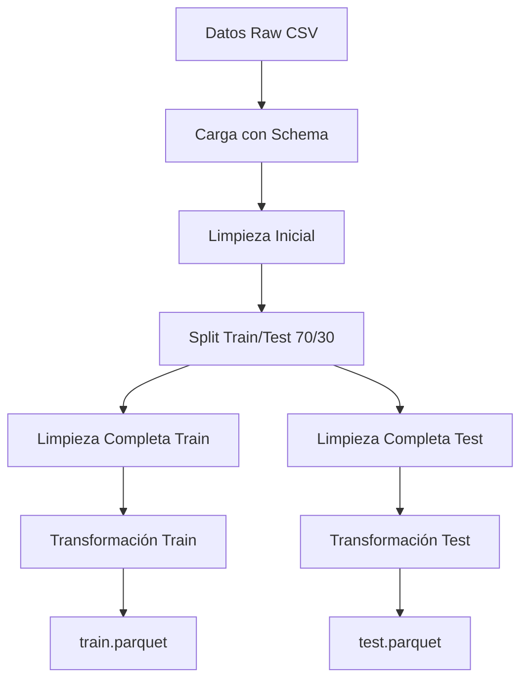

# Proyecto de Clasificación: KDD Cup 1999

**Asignatura:** Técnicas Escalables de Análisis de Datos en Entornos Big Data: Clasificadores  
**Universidad:** [Nombre de la Universidad]  
**Curso:** 2026-2027  
**Grupo:** [Número]

## Descripción del Proyecto

Este proyecto implementa un sistema de detección de intrusiones utilizando el dataset KDD Cup 1999 y Apache Spark ML. Se trata de la primera etapa del proyecto, que incluye la exploración exhaustiva y preparación de los datos para la posterior construcción de modelos de clasificación.

## Dataset

**KDD Cup 1999 - Network Intrusion Detection**

- **Origen:** DARPA 1998 Intrusion Detection Evaluation Program
- **Tamaño:** 4.9 millones de conexiones de red
- **Características:** 41 atributos + 1 etiqueta (attack_type)
- **Clases:** 5 categorías (normal, DoS, Probe, R2L, U2R)
- **Fuente:** [UCI Machine Learning Repository](https://archive.ics.uci.edu/ml/datasets/KDD+Cup+1999+Data)

## Estructura del Proyecto

```
proyecto-kdd-cup-1999/
│
├── README.md                         # Este archivo
├── .gitignore                        # Archivos a ignorar en git
│
├── memoria/                          # Documentación del proyecto
│   ├── informe.md                    # Informe principal (en español)
│   ├── atributos_kdd99.md           # Descripción de todos los atributos
│   ├── referencias.bib               # Referencias bibliográficas
│   └── imagenes/                     # Gráficos y visualizaciones
│
├── scripts/                          # Scripts Scala para Spark
│   ├── README.md                     # Instrucciones de ejecución
│   ├── procesamiento.scala           # Script principal (ejecutar este)
│   ├── exploracion.scala             # Análisis exploratorio de datos
│   ├── limpieza.scala                # Módulo de limpieza de datos
│   └── transformacion.scala          # Módulo de transformación de datos
│
├── datos/                            # Datos del proyecto
│   ├── README.md                     # Información sobre los datos
│   ├── raw/                          # Datos originales (descargar aquí)
│   └── processed/                    # Datos procesados (generados)
│
└── notebooks/                        # Notebooks para análisis adicional
```

## Inicio Rápido

### 1. Descargar los Datos

```bash
cd datos/raw/
wget http://kdd.ics.uci.edu/databases/kddcup99/kddcup.data.gz
gunzip kddcup.data.gz
```

### 2. Ejecutar el Procesamiento

```bash
# Iniciar Spark Shell
spark-shell --driver-memory 6g --executor-memory 4g

# Dentro de Spark Shell, cargar el script principal
:load scripts/procesamiento.scala
```

**Importante:** Modificar la variable `PATH` en `procesamiento.scala` antes de ejecutar.

### 3. Resultados

Los datos procesados se generarán en `datos/processed/`:
- `train.parquet` - Conjunto de entrenamiento (70%)
- `test.parquet` - Conjunto de prueba (30%)

## Requisitos

- **Apache Spark:** 4.1.3 o superior
- **Scala:** 2.12 (incluido con Spark)
- **Java:** JDK 8 o 11
- **Memoria:** Mínimo 8 GB RAM
- **Espacio en disco:** ~10 GB libres

## Contenido de la Primera Etapa

### 1. Resumen Ejecutivo del Dataset
- Origen y propósito de los datos
- Tamaño y características
- Distribución de clases
- Descripción detallada de los 41 atributos

### 2. Exploración de Datos
- Análisis estadístico descriptivo
- Visualización de distribuciones
- Análisis de correlaciones
- Detección de outliers
- Identificación de problemas de calidad

### 3. Preparación de Datos

#### 3.1 Creación de Conjuntos
- Split estratificado 70/30 (train/test)
- Preservación de distribución de clases

#### 3.2 Limpieza
- Eliminación de registros inválidos
- Tratamiento de valores ausentes
- Manejo de outliers (winsorización)
- Cálculo de métricas NTAIE y NTOE

#### 3.3 Selección de Atributos
- Eliminación de atributos sin varianza
- Análisis de relevancia de features

#### 3.4 Transformación
- Mapeo de 23 tipos de ataque a 5 categorías
- Codificación de variables categóricas (StringIndexer + OneHotEncoder)
- Normalización de features numéricas (StandardScaler)
- Ensamblado de vector de features para Spark ML

## Documentación

### Informe Principal
El informe completo en español se encuentra en [`memoria/informe.md`](memoria/informe.md). Incluye:
- Introducción y contexto
- Resumen ejecutivo (máx. 500 palabras)
- Exploración detallada de datos
- Metodología de preparación
- Conclusiones y próximos pasos
- Distribución del trabajo del equipo

### Descripción de Atributos
Documentación completa de los 42 atributos del dataset en [`memoria/atributos_kdd99.md`](memoria/atributos_kdd99.md).

### Instrucciones de Scripts
Guía detallada de uso de los scripts Scala en [`scripts/README.md`](scripts/README.md).

### Información de Datos
Detalles sobre descarga y formato de datos en [`datos/README.md`](datos/README.md).

## Pipeline de Procesamiento



## Transformaciones Aplicadas

### Features Numéricas (40 atributos)
- Normalización con StandardScaler (media=0, std=1)
- Manejo de outliers mediante winsorización

### Features Categóricas (3 atributos)
- `protocol_type`: 3 categorías → StringIndexer + OneHotEncoder
- `service`: ~70 categorías → StringIndexer + OneHotEncoder
- `flag`: 11 categorías → StringIndexer + OneHotEncoder

### Variable Objetivo
- Mapeo de 23 tipos de ataque a 5 categorías
- Conversión a índices numéricos (0-4) con StringIndexer

### Vector Final
- Dimensión: ~120-130 features
- Formato: DenseVector compatible con Spark ML

## Métricas de Calidad

### Conjunto de Entrenamiento
- Registros originales: ~4.9M
- Registros procesados: ~3.4M (70%)
- Tratamiento de outliers: Winsorización

### Conjunto de Prueba
- Registros originales: ~1.5M (30%)
- NTAIE (Ausentes/Inconsistentes): [completar después de ejecución]
- NTOE (Outliers): [completar después de ejecución]
- Tasa de no clasificados: < 1% (esperado)

## Próximos Pasos (Entregable Individual)

1. **Construcción del Modelo**
   - Entrenar árbol de decisión con Spark ML
   - Ajustar hiperparámetros

2. **Evaluación**
   - Calcular métricas: accuracy, precisión, recall, F1-score
   - Analizar matriz de confusión
   - Considerar desbalanceo de clases

3. **Optimización**
   - Técnicas para clases minoritarias (SMOTE, class weights)
   - Prueba de otros clasificadores (Random Forest, GBT)

## Equipo

**Integrantes del Grupo [X]:**
- [Nombre 1] - [Tareas]
- [Nombre 2] - [Tareas]
- [Nombre 3] - [Tareas]

## Referencias

- Stolfo et al. (2000). Cost-based modeling for fraud and intrusion detection: Results from the JAM project.
- Tavallaee et al. (2009). A detailed analysis of the KDD CUP 99 data set.
- Apache Spark MLlib Documentation: https://spark.apache.org/docs/latest/ml-guide.html

Ver [`memoria/referencias.bib`](memoria/referencias.bib) para la lista completa.

## Licencia y Citas

El dataset KDD Cup 1999 está disponible públicamente a través del UCI Machine Learning Repository. Si utiliza este código o dataset, por favor cite:

```
Stolfo, S. J., Fan, W., Lee, W., Prodromidis, A., & Chan, P. K. (2000).
Cost-based modeling for fraud and intrusion detection: Results from the JAM project.
Proceedings DARPA Information Survivability Conference and Exposition. DISCEX'00.
```

## Contacto

Para preguntas o problemas con el proyecto:
- **Grupo:** [Número]
- **Email:** [emails de contacto]

---

**Última actualización:** 14 de octubre de 2026  
**Fecha de entrega:** 19 de octubre de 2026, 09:00 h (CET)  
**Nombre del entregable:** G[X]-E1PS.zip
